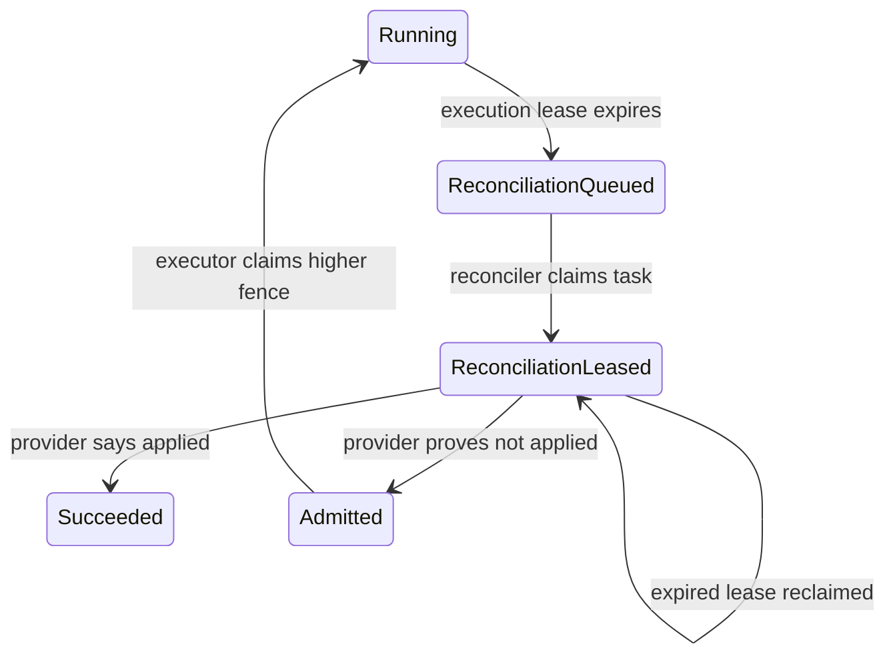

# Tool outcome reconciliation

An executor can call an external provider and lose its process before it records the result in the
local transaction. After the execution lease expires, the service cannot safely infer whether the
provider applied the operation. Retrying immediately could duplicate a non-idempotent side effect.

This recovery queue makes that uncertainty explicit and prevents a new execution until a fenced
reconciler resolves the original attempt.

## State transitions



The `(call_id, execution_attempt)` primary key creates at most one recovery task for an expired
execution fence. `BEGIN IMMEDIATE` serializes enqueue, lease and resolution updates in SQLite.

## API contract

1. An executor observes HTTP 409 with `expired execution requires outcome reconciliation` when it
   tries to claim an expired running call. That observation also durably enqueues the task.
2. A reconciler leases the oldest available task:

   ```http
   POST /tool-reconciliations/claim
   Content-Type: application/json

   {"reconciler_id":"provider-reconciler-1","lease_seconds":300}
   ```

   Only a response with `should_reconcile: true` authorizes the provider lookup. An identical active
   lease is not handed to a competitor; an expired reconciliation lease is reclaimed with a higher
   `reconciliation_attempt` fence.
3. The reconciler queries the provider using the stable reference already held by the integration.
   It then resolves the task with the exact execution and reconciliation fences:

   ```http
   POST /tool-reconciliations/identity-check-1/resolve
   Content-Type: application/json

   {
     "execution_attempt":1,
     "reconciliation_attempt":1,
     "reconciler_id":"provider-reconciler-1",
     "decision":"applied",
     "result":{"status":"verified","provider_reference":"provider-result-7"}
   }
   ```

   `applied` requires the same strict, server-owned result schema as a normal completion. The raw
   result is validated and discarded; only its SHA-256 identity is stored. `not_applied` forbids a
   result payload and is the only decision that permits a later executor to obtain a higher fence.

## Operational snapshot

`GET /metrics/tool-reconciliation` recomputes one JSON snapshot from the durable queue on every
request. The fixed schema exposes:

- unresolved queue depth with queued and leased splits;
- leases that are currently expired and tasks that have been reclaimed at least once;
- whole-second age of the oldest unresolved task;
- mean and maximum time from durable enqueue to resolution; and
- total resolved, `applied`, and `not_applied` decisions.

Empty latency and age series are returned as `null`, not zero. A resolution replay does not
increment any value because it does not create another durable decision. The endpoint deliberately
has no task-level dimensions: call IDs, case IDs, execution fences, worker/reconciler identities,
provider references, and result digests are excluded. Production alert thresholds remain an
operator policy—for example, a non-zero expired-lease count or an oldest age beyond the provider's
lookup objective.

Resolution retries are safe only when reconciler identity, both fences, decision and result identity
match the committed receipt. A stale owner, expired lease, changed policy or conflicting resolution
returns HTTP 409. An invalid provider response returns HTTP 422 and leaves the task leased so the
operator can correct or escalate it.

## Invariants and limitations

- No expired execution is automatically retried.
- `applied` preserves the original executor attempt and binds its new terminal receipt into the
  reconciliation receipt.
- `not_applied` clears the old lease but preserves its attempt counter, so the next claim is strictly
  higher.
- Raw executor IDs, reconciler IDs and provider response values are not persisted in receipts.
- The service trusts the provider lookup. If the provider is eventually consistent or cannot prove
  absence, the reconciler must not choose `not_applied`.
- SQLite and the provider remain separate systems. Provider idempotency keys are still the preferred
  first line of defense; this queue is the fail-closed recovery path.
- The snapshot reports current database state; it does not retain a time series, page individual
  tasks, or prove that an external metrics collector scraped it. Its exact aggregate scans the
  retained reconciliation table; high-volume deployments need a retention policy or verified
  rollup. Long-term rates and percentile latency require a trusted telemetry backend.
